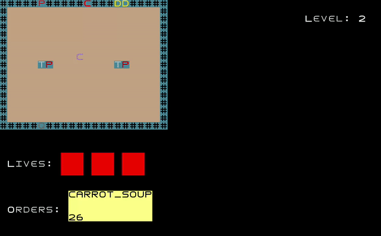
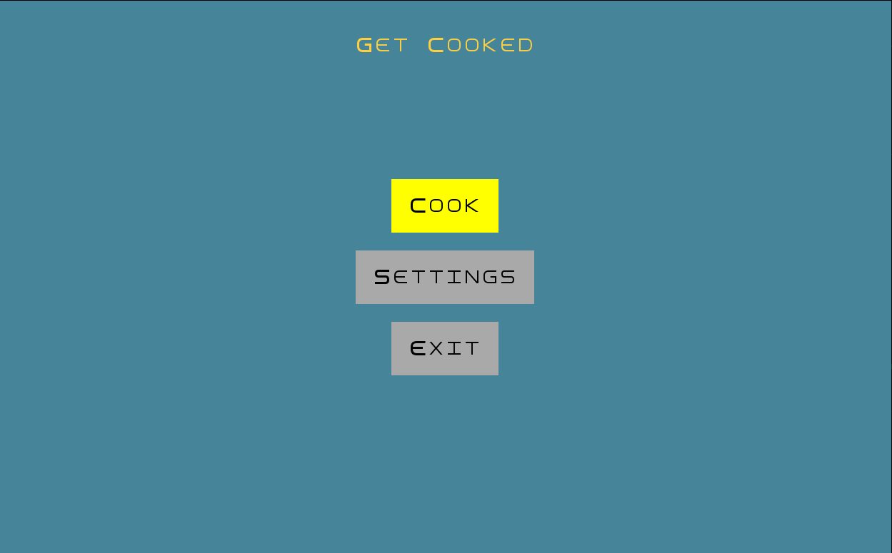
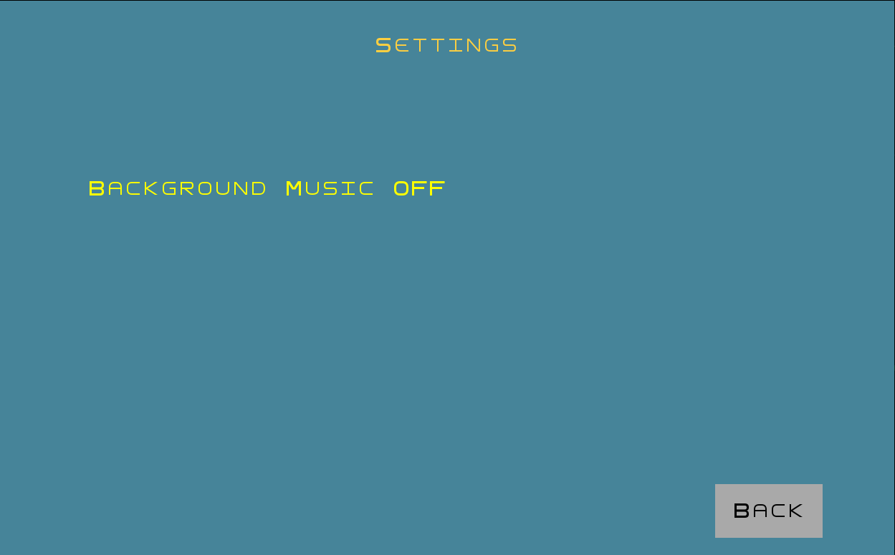
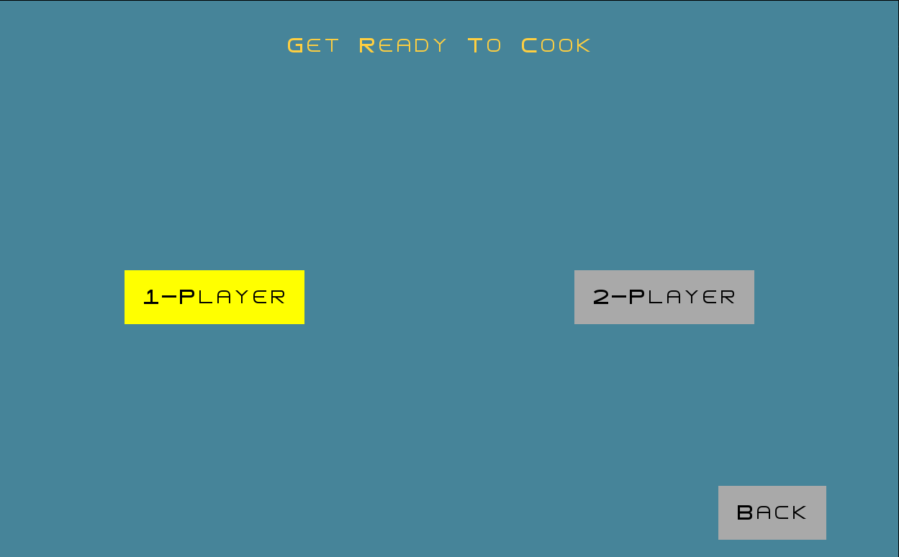
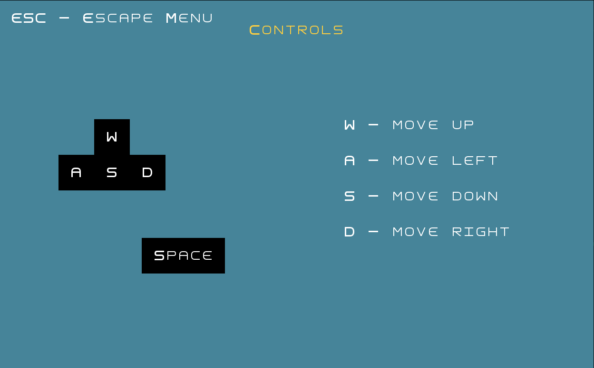
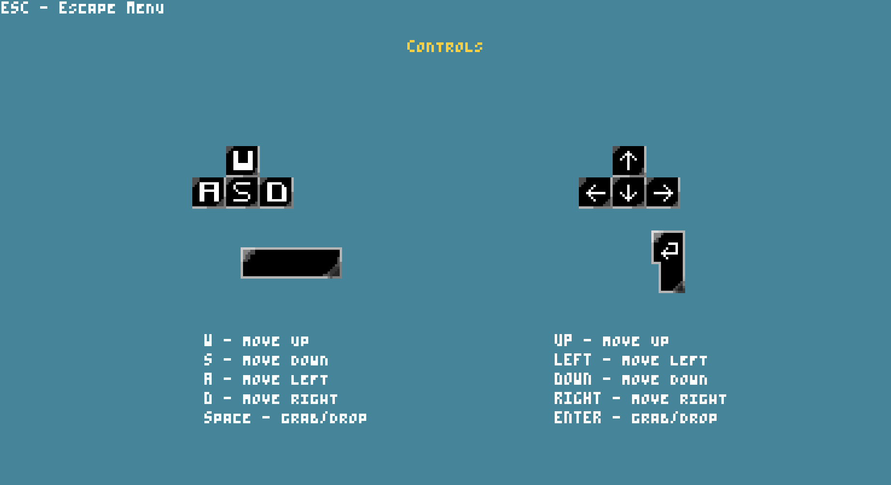
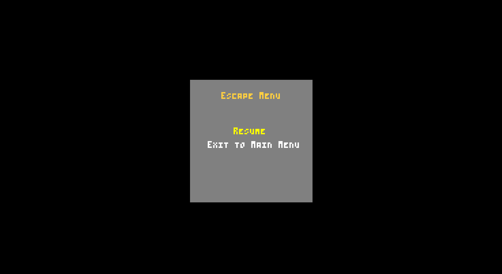
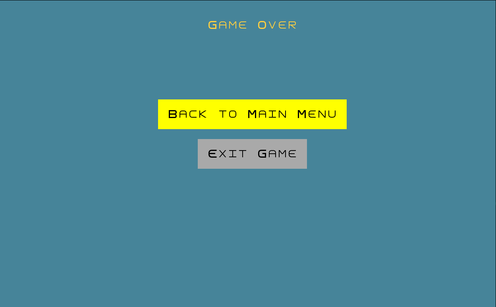

# LDTS_T05_G01 - GET COOKED

## Game Description

In Get Cooked you will experience true hell in the kitchen.
Alone or with a friend you must prepare dishes to satisfy food orders, that will become faster and increase in number each round.

This project was developed by *Gabriel Magalhães* (*up202405890@fe.up.pt*), *Guilherme Cunha* (*up202405961@fe.up.pt*) and *Pedro Pires* (*up202405967@fe.up.pt*) for LDTS 2025⁄26.

For a more detailed version of this description click [here](./docs/README.md).

## Screenshots

The following screenshots ilustrate the general look of our game.
### Game preview

  

  <b><i>Gif 1. Short Get Cooked gameplay</i></b>

 
 

### Menus

  

  <b><i>Fig 1. Main Menu</i></b>

 
 

 

  

  <b><i>Fig 2. Settings Menu</i></b>

 
 

  

  <b><i>Fig 3. Cook Menu</i></b>

 
 

  

  <b><i>Fig 4. 1-Player Controls Info Menu</i></b>

 
 

  

  <b><i>Fig 5. 2-Player Controls Info Menu</i></b>

 
 

  

  <b><i>Fig 6. Escape Menu</i></b>

 
 

  

  <b><i>Fig 7. Game Over Menu</i></b>

 
 

