## LDTS_2LEIC0501 - GET COOKED

### THEME

In Get Cooked you will experience true hell in the kitchen.
Alone or with a friend you must prepare dishes to satisfy food orders, that will become faster and increase in number each round.

This project was developed by *Gabriel Magalhães* (*up202405890@fe.up.pt*), *Guilherme Cunha* (*up202405961@fe.up.pt*) and *Pedro Pires* (*up202405967@fe.up.pt*) for LDTS 2025⁄26.

### IMPLEMENTED FEATURES
- **Single Player and Two-Player Modes** - The game can be played by one or two players, in the same device (locally),
with customized difficulty.
- **Connected Menus** - The user has the capability of browsing through the different menus including in game ones, using 
interactive buttons (ex: Main Menu, Cook Menu, Settings, Escape Menu). 
Once the player(s) lose, a Game Over Menu is prompted, showing the total number of orders fulfilled and options to 
exit the game and to return to the Main Menu.
- **Background Music** - The game has background music with adjustable volume level 
and can be turned on or off in the Settings Menu.
- **Collisions detection** - Collisions between chef's and interactables 
(counters, delivery spots, dispensers, cookwares) are verified.
- **Grab** - When not holding anything, chefs will grab food and plates by pressing the space bar and enter keys, for player 1 and player 2, respectively.
- **Drop** - When holding something, chefs will drop food and plates by pressing the space bar and enter keys, for player 1 and player 2, respectively.
- **Pot cooking** - When the Pot cookware receives a chopped potato or carrot, 
it will generate a potato soup or a carrot soup which, after 4 seconds, can be collected by a chef holding a plate, and delivered.
Grill and Fryer have similar behaviour.
- **Trash** - When a chef interacts with a trash bin, all the things he was holding get dumped.
- **Delivery Spot** - Chefs can only deliver orders in the delivery spots.
- **Dispensers** - Chefs can get raw foods from dispensers by interacting with them.
- **Cutter** - Chefs can chop raw foods  by interacting with cutters pressing space or enter 5 times. 
CounterCutter and KebabCutter share this behaviour, even though a plate is needed to collect the ready kebab.
- **Counters** - Chefs can place grabables on counters and pick them up from there.
- **Order Generation** - Orders are randomly generated in accordance to the existent foods and interactables in the current kitchen map.
- **Order Matching** - Chefs can only fulfill orders that are currently active. Once an active order is fulfilled, it will leave the active orders queue.
- **Orders by level** - A higher level means more orders per level and a higher frequency of orders (orders come faster).
- **Lives** - The playing session ends when there are no more lives left.
- **Sprites** - The game uses sprites for enhanced game visuals.
- **Game Progression** - The game gets progressively harder as the player(s) advance through levels,
    with more orders to fulfill, with greater diversity and less time to do so.
- **Enhanced Resolution** - The game's resolution adapts to the pc's screen resolution.

  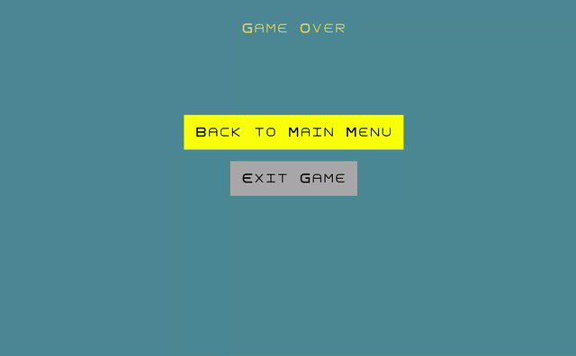

  <b><i>Gif 1. Menu Navigation  </i></b>

 
 

  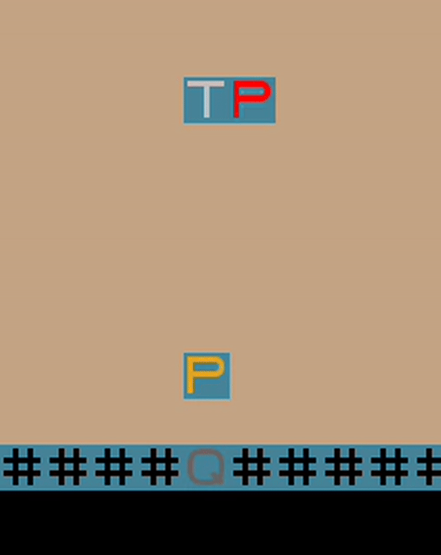

  <b><i>Gif 2. Pot cooking  </i></b>

 
 

  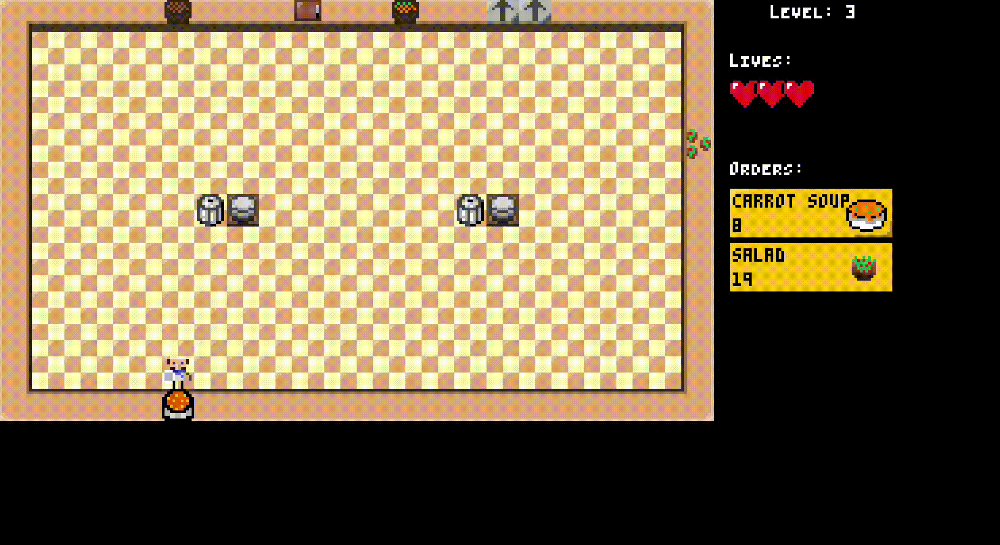

  <b><i>Gif 3. Order Matching  </i></b>

 
 

  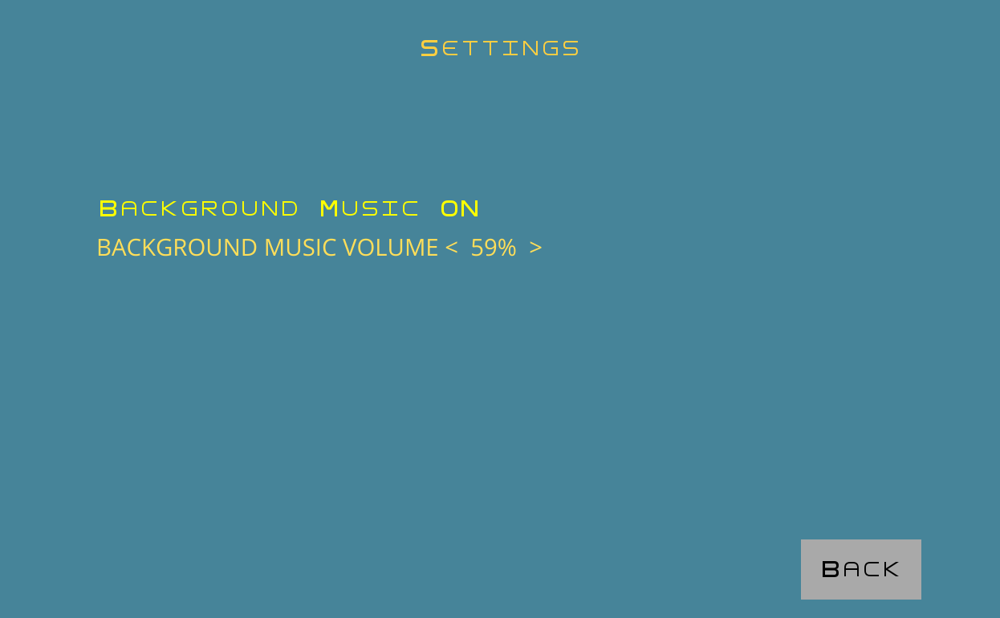

  <b><i>Fig 1. Volume Option Mock-Up  </i></b>

 
 

  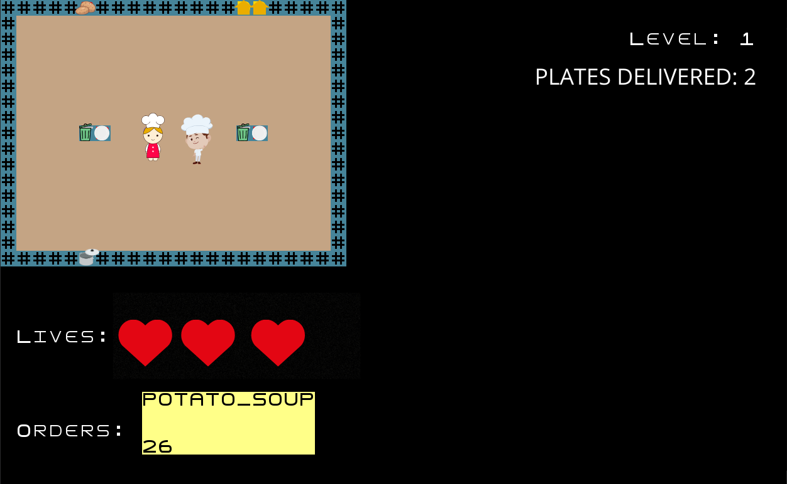

  <b><i>Fig 2. Very Simple Kitchen Mock-Up  </i></b>

 
 

### UML DIAGRAMS

These are the UML diagrams of each package of the project. 

  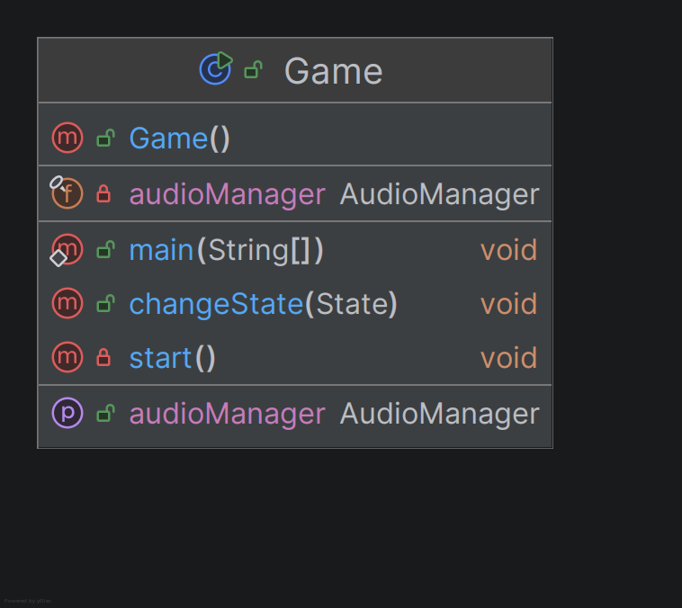

  <b><i>Fig 3. Game UML  </i></b>

 

  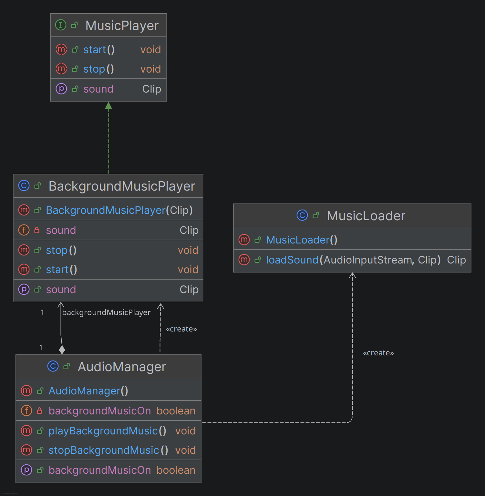

  <b><i>Fig 4. Music UML  </i></b>

 

  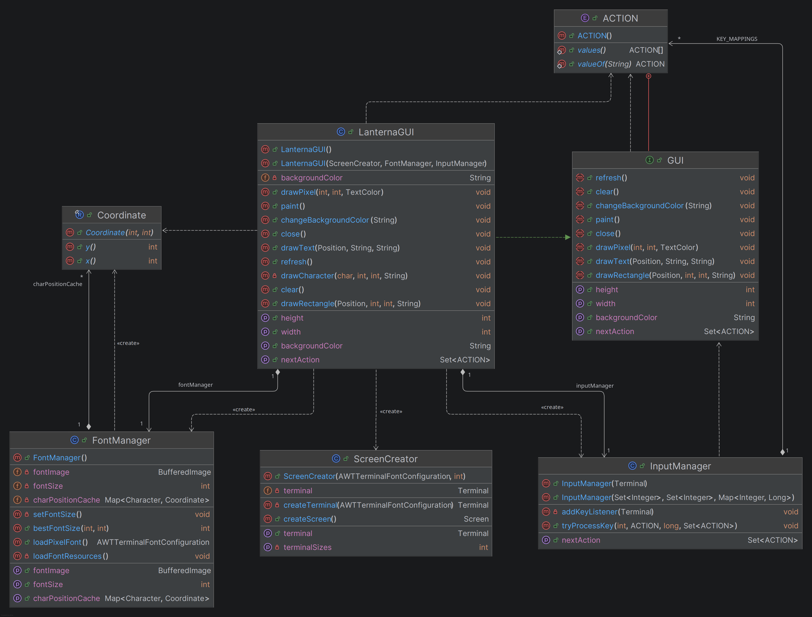

  <b><i>Fig 5. GUI UML  </i></b>

 

  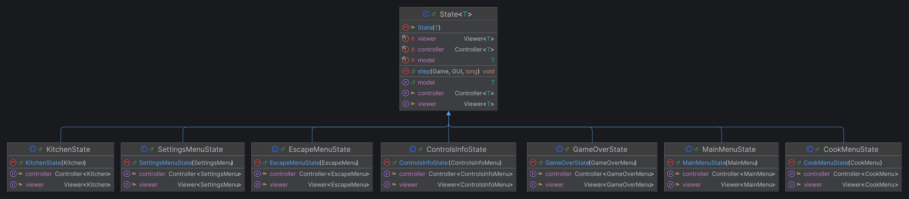

  <b><i>Fig 6. States UML  </i></b>

 

  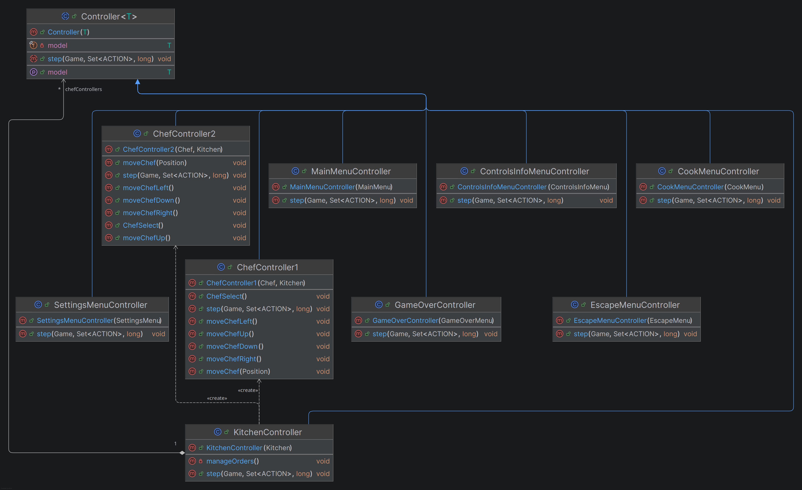

  <b><i>Fig 7. Controller UML  </i></b>

 

  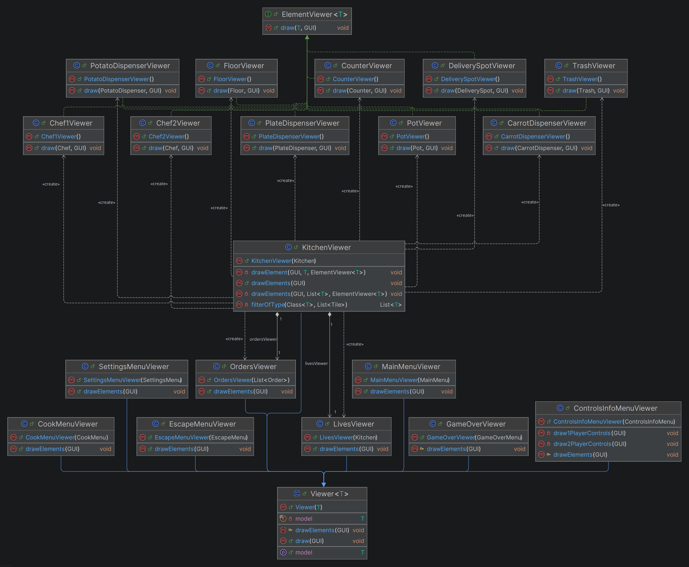

  <b><i>Fig 8. Viewer UML  </i></b>

 

  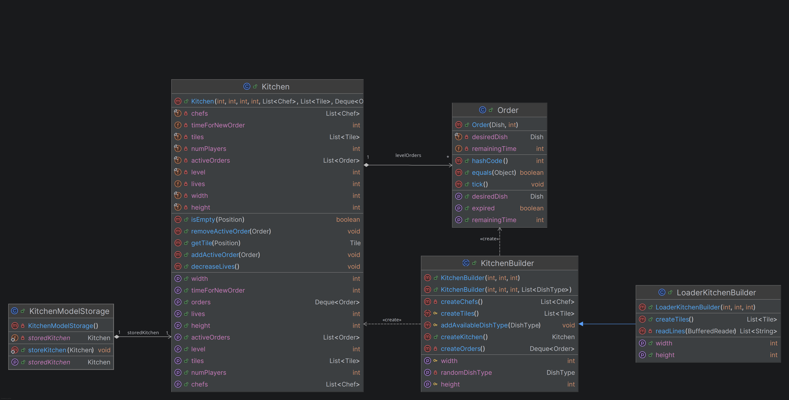

  <b><i>Fig 9. Kitchen UML  </i></b>

 

  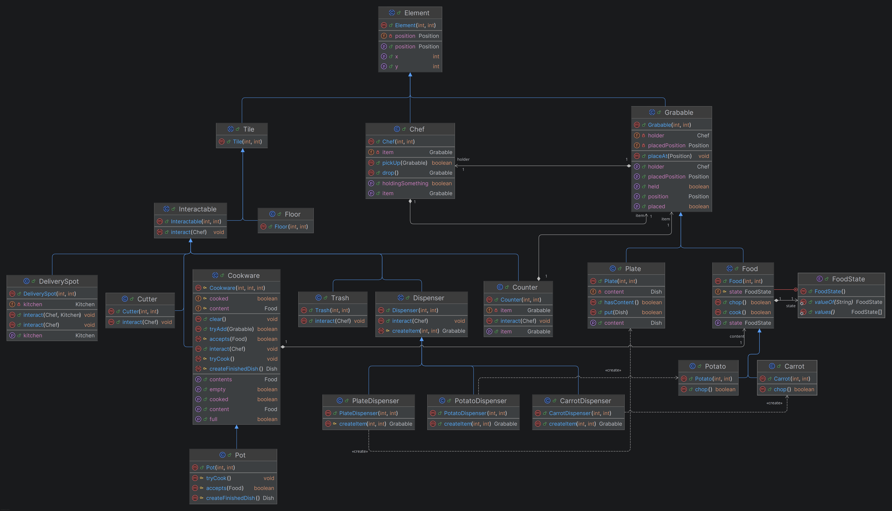

  <b><i>Fig 10. Elements UML  </i></b>

 

  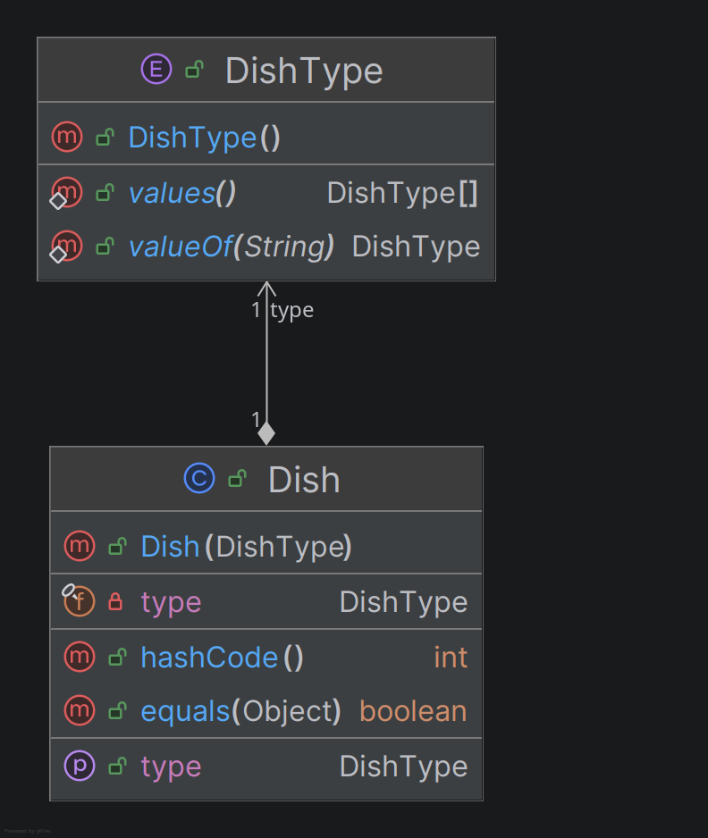

  <b><i>Fig 11. Dish UML  </i></b>

 

### DESIGN

#### General Code Structure

- **Problem in Context** 
When developing software that relies on a user interface, it's crucial to choose a proper structure. The code must stay organized and separated so the Single Responsability Principle isn't broken. Due to this, we applied the architectural pattern **Model/Viewer/Controller**, which is very common when using a GUI.

- **The Pattern** 
For our game, this means that we must implement dedicated parts for each task - handling inputs, rendering graphics and managing game logic. It consists on three different sections:
  - **Model** - responsible for storing the game's data, rules and logic.
  - **Viewer** - in charge of rendering the current state of the model.
  - **Controller** - processes the player's inputs and translates it in to actions that update the model.

- **Implementation** 
The implementation of this Architectural Design can be seen by the following diagram:

  

    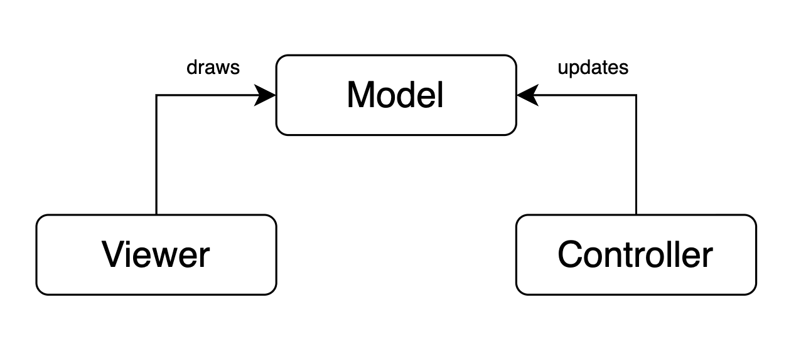
  

  

    <b><i>Fig 12. MVC Architetural Design  </i></b>
  

   

- **Consequences** 
Using the Model/Viewer/Controller design brings some advantages, such as:
  - Clear separation of responsibilities, acknowledging the Single Responsibility Principle.
  - Easier to implement new features due to the the separation of responsabilities. So that when adding or changing new features does not directly affect others.

#### Game Loop
- **Problem in Context**  
  A game requires a continuous cycle of execution to process user input, update states, and render visuals. A critical challenge in this cycle is time consistency: the game simulation must progress at a predictable speed, ensuring a consistent gameplay experience regardless of the user's hardware performance or processor speed.

- **The Pattern**  
  The identified solution was the Game Loop design pattern. This pattern decouples the progression of game from user input and processor speed. By separating the game simulation from the rendering cycle, it ensures the game runs at a consistent framerate, regardless of the underlying hardware performance.

- **Implementation**  
  In our game, the Game Loop is implemented in the start() method of the Game class, also the entry point of the whole game. It operates at a fixed frame rate of 30 FPS, which translates to approximately 33 milliseconds per frame. 
  At the beginning of execution, background music is initialized and begins playing continuously throughout gameplay.

  Each iteration of the loop performs the following steps:
  - Record Frame Start Time: Capture the current system time to measure frame execution duration.
  - Update Game State: Call the step() method of the State class (will be explored later, but essentially handles user input actions and updates game logic and renders elements).
  - Calculate Sleep Duration: Compute the remaining time in the frame by subtracting elapsed execution time from the target frame duration.
  - Sleep if Necessary: If processing completed early, sleep for the remaining time to maintain the consistent 30 FPS target.
  The loop continues as long as a valid game state exists. When the state becomes null (indicating the player has exited), the loop terminates, background music stops, and the GUI closes gracefully.

  

    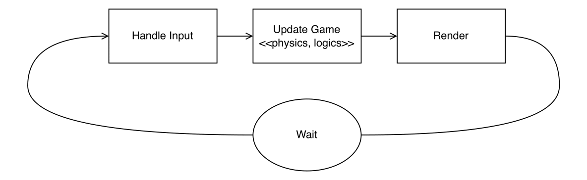
  

  

    <b><i>Fig 13. Game Loop</i></b>
  

   

- **Consequences**  
  As said before, implementing this pattern has a multitude of advantages. However, Thread.sleep() makes the loop reliant on busy-waiting, which is not a very good practice since CPU cycles are being wasted.

#### Abstract Factory
- **Problem in Context**  
  The game comprises multiple distinct execution states such as MainMenuState, SettingsMenuState, and KitchenState (the active gameplay state). To manage these effectively, we needed a design that balanced customization with code reuse.

  While each state requires unique Viewers and Controllers tailored to the specific needs of that state, they all share the same underlying architecture: the Model-Viewer-Controller (MVC). 
  The system would benefit from defining a family of related state classes that share this common structure while preserving the extensibility needed to implement distinct behaviors for menus versus gameplay.

- **The Pattern**  
  The identified solution was the Abstract Factory design pattern. This pattern allows the creation of family related objects without specifying their concrete classes, relying on an abstract class that builds the backbone for the implementation, done by the concrete implementations through method overriding. 

- **Implementation**  
  To model this, a generic class, parameterized with the type T, which represents the specific type of the model associated with that state, serving as the base class for all possible game states, encapsulating the core MVC structure, a Model (T), a Viewer and a Controller.
  Through these overrides, the base class delegates the responsibility of specifying exactly which Viewer and Controller to use to the concrete subclasses.

- **Consequences**   
  - Polymorphism: This approach enables the Game Loop to treat all states polymorphically (calling the same step() method on any active state);
  - Extensibility: Respects the Open/Closed Principle, since its possible to introduce new states without breaking the existing code;
  - Although introducing a new interface and multiple concrete classes added some initial complexity, the game architecture significantly benefited from the structural clarity and decoupling provided by this pattern.

#### Game States

- **Problem in Context** 
Since our game has multiple game states (MainMenu, SettingsMenu, EscapeMenu, etc.), we had to find a way to keep the current state of the game and manage them without creating complex and large conditional statements.

- **The Pattern** 
For this problem, we adopted the **State** pattern. This pattern allows each game state to be represented as a class with its own behaviour, while the main game loop simply delegates actions to the current state. All state classes extend an abstract class called State.

- **Implementation** 
In our code, the State Pattern is centered arround the **Game** class, but most of the actual logic is contained in the states package. This package defines the general **State** class, which acts as a type of template, and the specific implementations: **MainMenuState**, **SettingsMenuState**, **CookMenuState**, **ControlsInfoState**, **EscapeMenuState** and **KitchenState**. Each state handles its own inputs, updates and rendering.

  Diagram that represents the State pattern:

  

    
  

  

    <b><i>Fig 14. State Pattern  </i></b>
  

   

  State diagram showing how state transitions are proceeded during the game:

  

    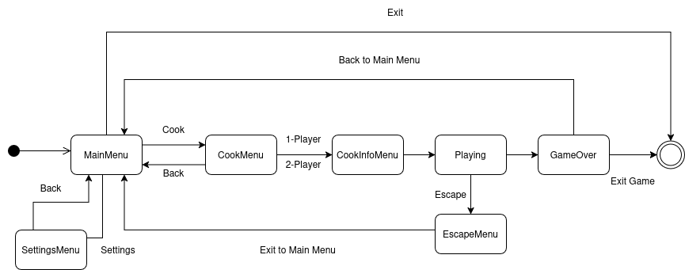
  

  

    <b><i>Fig 15. State Diagram  </i></b>
  

   

- **Consequences** 
  This approach provided several benefits:
  - Keeping the code well organized and respecting the Single Responsibility Principle.
  - Adding new states can be done without modifying existing states. This allows the code to be more modular, following a Open/Closed Principle.
  - Switching between states becomes simple and very consistent, reducing risks of errors.

#### GUI

- **Problem in Context** 
In our game we needed to render the element and handle player inputs using Lanterna. However, Lanterna's API is not very convenient to use. If we relied on it, our code would become very messy and repetitive, making it harder to test or replace it later. So we needed a cleaner layer between our game logic and the library.

- **The pattern** 
We opted to use the **Adapter** pattern. This pattern creates an object that will translate one interface into another. In our case, the game interacts only with the simple GUI interface, while LanternaGUI adapter handles all Lanterna specific details on the backend, with its library.

- **Implementation** 
This implementation can be found in the gui package: the general GUI class and the specific LanternaGUI (adapter).

 

    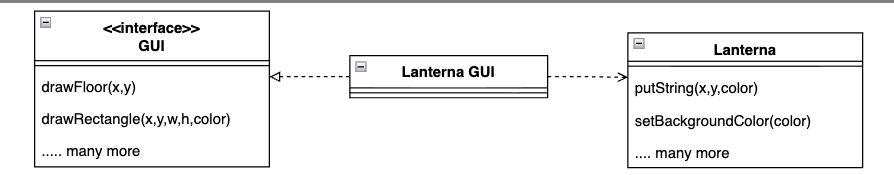
  

  

    <b><i>Fig 16. Adapter Pattern  </i></b>
  

   

- **Consequences** 
By using the Adapter pattern, we avoid spreading Lanterna code throughout the project, providing several benefits:

  - Lanterna specific code stays inside the adpater, making sure that other classes don't need to deal with them.
  - Each class focuses only on its own logic, providing the Single Responsibility Pattern.
  - Increases the modularity of code. The GUI is isolated, making it easier to understand and maintain.

#### KNOWN CODE SMELLS

- **Duplicated code**: chef's viewers and controllers - probably can be solved.
- **Big classes**:
  - Kitchen  - although needed since it must manage most of the game logic; 
  - LanternaGUI - if using sprites can be reduced instead of having a specific method for each element to be drawn.
- **Long methods**: getNextaction and tryProcessKey are quite long methods but they are responsible for the core movement mechanics of the game.

### TESTING

    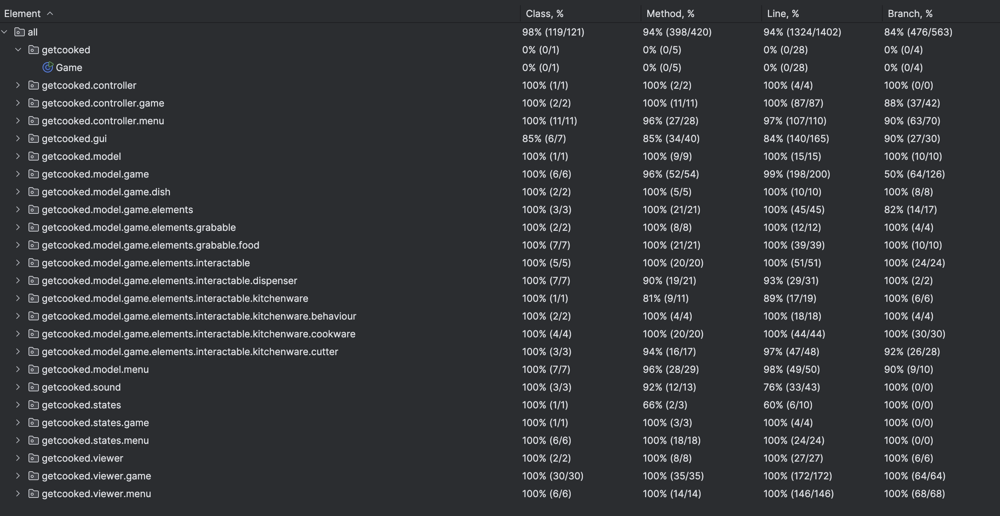
  

  

    <b><i>Fig 17. Test Coverage</i></b>
  

   

    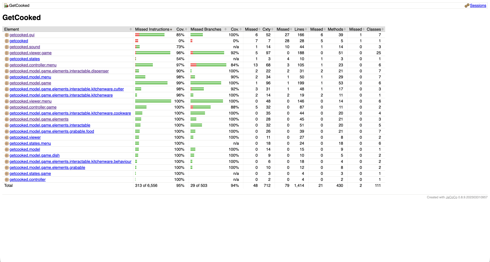
  

  

    <b><i>Fig 18. Jacoco Test Coverage</i></b>
  

   

    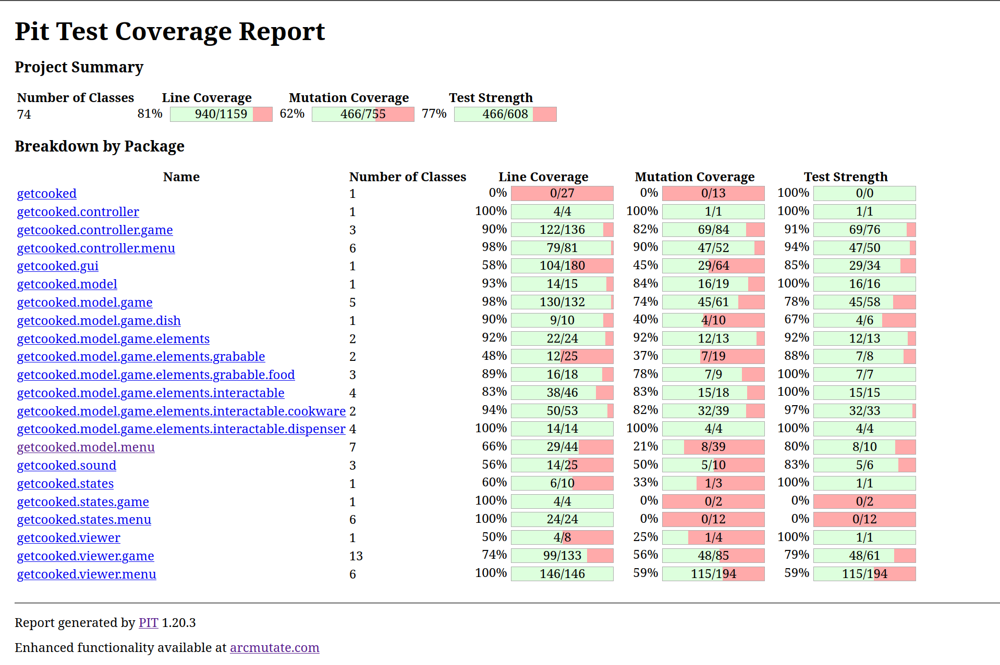
  

  

    <b><i>Fig 19. Pitest Mutation Testing</i></b>
  

   

### SELF-EVALUATION

The members of the group contributed equally to the project, therefore the work distribution is:  

- Gabriel Magalhães: 33.3%
- Guilherme Cunha: 33.3%
- Pedro Pires: 33.3%